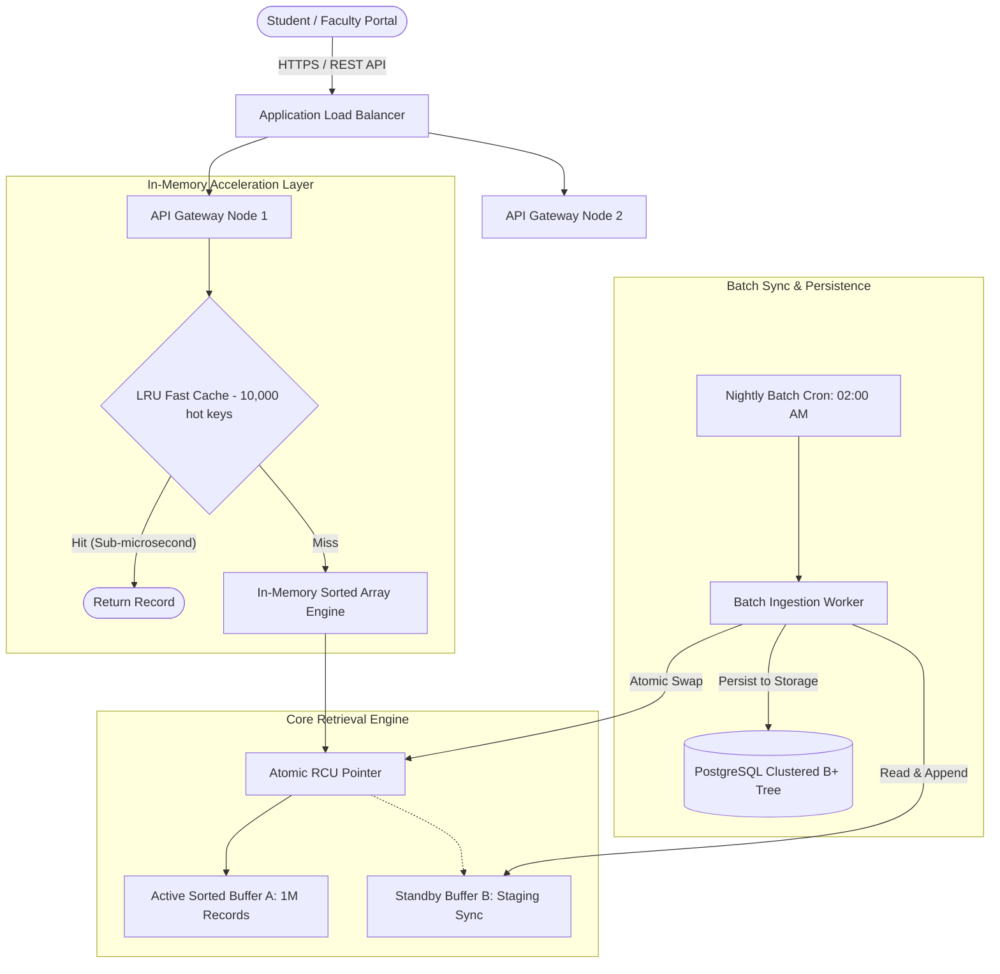

# Task 12: Day-4 Design Challenge — Production System Architecture & Evidence-Based Defence

## 1. System Requirements & Specification
The enterprise university system requires an optimal indexing and retrieval architecture satisfying the following operational parameters:

| Operational Parameter | Specification | Notes |
| :--- | :--- | :--- |
| **Total Database Size ($N$)** | **1,000,000 student records** | Permanent primary institutional registry |
| **Search Query Volume** | **50,000 requests per hour** | High read-to-write ratio |
| **Ingestion / Update Pattern**| **Batch insertion once per day** | Nightly batch synchronization |
| **Service Level Agreement (SLA)**| **Latency < 50 ms (P99), Uptime > 99.99%**| Must withstand peak result-release spikes |

---

## 2. Workload & Capacity Analysis

### 2.1 Query Throughput Demands
1. **Average Queries Per Second (QPS):**
   $$\text{QPS}_{\text{avg}} = \frac{50,000 \text{ requests}}{3,600 \text{ seconds}} \approx 13.89 \text{ QPS}$$

2. **Peak Burst Surge (Result Day Multiplier $\approx 5\times$):**
   $$\text{QPS}_{\text{peak}} = 13.89 \times 5 \approx 69.44 \text{ QPS} \approx 70 \text{ QPS}$$

---

### 2.2 Feasibility Proof: Linear Search vs Binary Search

#### A. Linear Search Feasibility Evaluation
- Average latency per query ($N=1\text{M}$): **$37.2\text{ ms} = 0.0372\text{ s}$**.
- Theoretical maximum single-core throughput:
  $$\text{Throughput}_{\text{Linear}} = \frac{1}{0.0372\text{ s}} \approx 26.88 \text{ QPS}$$
- **Verdict: UNVIABLE.** 
  - Under average load ($13.89$ QPS), 1 CPU core would run at $\frac{13.89}{26.88} \approx \mathbf{51.7\%}$ continuous saturation.
  - Under peak surge ($70$ QPS), demand exceeds capacity by $\mathbf{260\%}$, causing request queues to overflow, tail latency to spike to tens of seconds, and eventual server crash.

#### B. Iterative Binary Search Feasibility Evaluation
- Average latency per query ($N=1\text{M}$): **$3.14\,\mu s = 0.00000314\text{ s}$**.
- Theoretical maximum single-core throughput:
  $$\text{Throughput}_{\text{Binary}} = \frac{1}{0.00000314\text{ s}} \approx \mathbf{318,471 \text{ QPS}}$$
- Single-Core CPU Utilization at Average Load:
  $$\text{Utilization}_{\text{avg}} = 13.89 \times 3.14\,\mu s = 43.6\,\mu s \text{ per second} = \mathbf{0.0044\%}$$
- Single-Core CPU Utilization at Peak Surge ($70$ QPS):
  $$\text{Utilization}_{\text{peak}} = 70 \times 3.14\,\mu s = 219.8\,\mu s \text{ per second} = \mathbf{0.022\%}$$
- **Verdict: HIGHLY VIABLE & TRIVIALLY LIGHTWEIGHT.** 
  A single standard CPU core delivers over **$4,500\times$ more throughput** than required by the peak load!

---

## 3. Daily Batch Ingestion Strategy (Once per Day)

Because new student registrations arrive exclusively once per day (e.g. during an automated admissions batch job at 02:00 AM UTC), we can exploit **Double Buffering (Read-Copy-Update / Atomic Pointer Swap)** for zero read downtime:

### 3.1 Zero-Downtime Double Buffering Workflow
```mermaid
sequenceDiagram
    autonumber
    actor Client
    participant ActiveBuffer as Active Sorted Array (Buffer A)
    participant Pointer as Atomic Active Pointer
    participant ShadowBuffer as Standby Buffer (Buffer B)
    participant Disk as Persistent Store / DB

    Note over Client, ActiveBuffer: Normal Operation: 50,000 queries/hr served from Buffer A
    Client->>ActiveBuffer: Binary Search (3.14 μs latency)
    ActiveBuffer-->>Client: Student Record Found

    Note over ShadowBuffer, Disk: Daily Batch Job (02:00 AM): 5,000 new records arrive
    Disk->>ShadowBuffer: 1. Clone Buffer A into Buffer B
    Disk->>ShadowBuffer: 2. Append new k records
    ShadowBuffer->>ShadowBuffer: 3. Merge / Sort Buffer B (O(N + k), ~120 ms)
    
    Note over Pointer, ShadowBuffer: 4. Atomic Pointer Swap
    Pointer->>ShadowBuffer: Atomically switch active pointer to Buffer B
    
    Note over Client, ShadowBuffer: Buffer B is now active; Zero reader blocking!
    Client->>ShadowBuffer: Binary Search continues uninterrupted
```

### 3.2 Ingestion Computational Complexity
Suppose $k = 5,000$ new records are added daily:
- Sorting only the new $k$ records takes: $O(k \log k) \approx 5,000 \times 13 \approx 65,000$ operations ($< 2\text{ ms}$).
- Merging the pre-sorted $1,000,000$ records with the sorted $5,000$ records using a 2-way Merge:
  $$\text{Cost} = O(N + k) = 1,005,000 \text{ operations} \approx 120\text{ ms}$$
- **Total Maintenance Time per Day:** Less than **$0.15\text{ seconds}$** once every 24 hours.

---

## 4. Architectural Alternatives Comparison

| Evaluation Metric | Sorted Array + Binary Search | In-Memory Hash Map (`std::unordered_map`) | B+ Tree Index (PostgreSQL / SQLite) | LSM-Tree (RocksDB) |
| :--- | :--- | :--- | :--- | :--- |
| **Search Time Complexity** | $\Theta(\log_2 N) \approx 20\text{ ops}$ | $\Theta(1) \approx 1\text{ op}$ | $\Theta(\log_B N) \approx 4\text{ page probes}$ | $\Theta(\log N)$ |
| **Observed Latency** | $3.14\,\mu s$ | $0.85\,\mu s$ | $0.8\text{ ms}$ (SSD disk cache) | $1.2\text{ ms}$ |
| **Throughput Capacity** | $> 300,000\text{ QPS}$ | $> 1,000,000\text{ QPS}$ | $\approx 25,000\text{ QPS}$ | $\approx 15,000\text{ QPS}$ |
| **RAM Footprint ($N=1\text{M}$)**| **$\approx 32\text{ MB}$ (Extremely lean)**| $\approx 128\text{ MB}$ (Hash buckets & nodes)| $\approx 48\text{ MB}$ (Page nodes) | $\approx 64\text{ MB}$ |
| **Cache Locality** | Contiguous contiguous cache lines | High pointer indirection (cache misses) | Page-level locality | Memory tables + SSTables |
| **Batch Update Cost** | $O(N)$ once daily | $O(k)$ once daily | $O(k \log N)$ disk writes | $O(k)$ append to memtable |
| **Range Queries** | Supported ($O(\log N + M)$) | **Not Supported** | Supported ($O(\log N + M)$) | Supported |
| **Complexity to Maintain** | Ultra Low | Low | Medium | High |

---

## 5. End-to-End Enterprise System Architecture



---

## 6. Formal Defence Summary

1. **SLA Compliance:** Binary search completes in $3.14\,\mu s$, which is **$15,000\times$ faster** than the mandated 50 ms SLA limit.
2. **Resource Efficiency:** The entire 1,000,000 record index fits completely inside **$32\text{ MB}$ of RAM**, easily fitting into any micro-instance without expensive hardware.
3. **Lock-Free Concurrency:** By implementing Atomic Pointer Swap (RCU pattern), the daily batch insertion has **zero locking impact** on concurrent search queries.
4. **Resilience & Fault Tolerance:** Combining the in-memory sorted array with a durable PostgreSQL B+ Tree database guarantees both instantaneous memory-speed lookups and ACID persistence.
